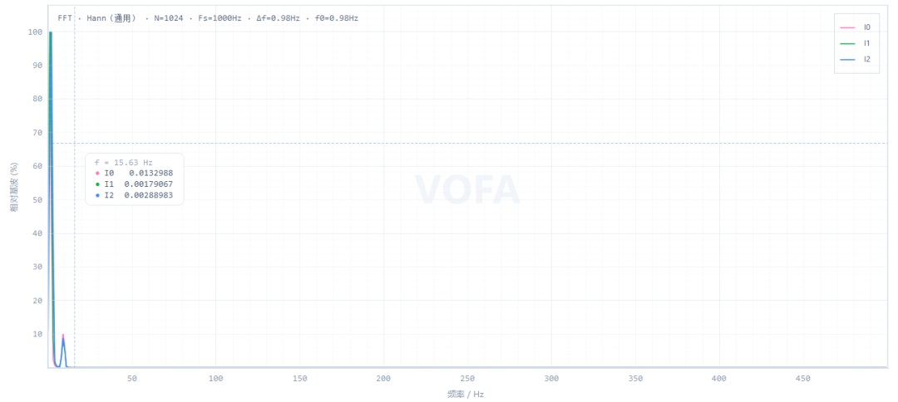

# VOFA+ Flash

**串口侧的波形与调参上位机：不接调试器，也能实时看曲线、改参数。**

VOFA+ Flash 用 Python + PySide6 + pyqtgraph 写成，界面参考 VOFA+ 的白色卡片风格：
顶栏一行接口参数、左侧命令抽屉、中央波形卡片、底部收发区、右侧变量栏，各区域都能拖动调整。
打包后就是一个单文件 `VOFA_Flash.exe`（窗口内显示名称为「VOFA+ Flash」），双击即用。


## 界面预览

| 显示控件与三轴 | 波形右键菜单 |
| --- | --- |
|  |  |

| FFT 频谱 | 多窗口 FFT + 时域 |
| --- | --- |
|  |  |

## 和 McuStudio 是什么关系

McuStudio 走 SWD / JTAG 直连芯片，提供寄存器、变量、断点这类**芯片内部视角**；
VOFA+ Flash 只占用一路 UART（也可 UDP / TCP），提供**整机外部视角**的波形与命令通道。
两者定位互补，不抢调试接口，可以同时开着用。

| | McuStudio | VOFA+ Flash |
| --- | --- | --- |
| 连接方式 | 调试器（SWD / JTAG） | 串口 / UDP / TCP 客户端 / TCP 服务端 |
| 主要用途 | 在线调试、断点、寄存器与内存 | 波形观察、参数实时下发、命令调试 |
| 硬件前提 | 调试口可用、需共地 | 只要有一路串口 |
| 典型现场 | 台架、裸板、样机 | 整机、装配后、高压大功率、隔离供电、远程 |

一句话：**能用调试器就用 McuStudio，只有串口就用 VOFA+ Flash。**

## 解决的串口调试痛点

| 现场痛点 | 这里的做法 |
| --- | --- |
| 板子只剩 UART，或高压 / 大功率不敢和调试器共地，SWD 又被占用 | 只占用串口 TX / RX / GND，完全不碰调试接口 |
| 调一个参数要「改代码 → 编译 → 烧录」 | 滑动条拖动即下发，默认按 `float32` 打包，不改代码不重启 |
| 多个参数要拼成一帧，字节数、字节序容易算错 | 多个滑块绑成一组后按顺序自动打包，卡片底部实时预览整帧 Hex |
| 串口助手只能看十六进制，看不出趋势 | JustFloat / ASCII / RawData 三种协议直接出曲线 |
| 想同时看时域波形和频谱，只能来回切工具 | 右键即可切到 FFT，支持单窗口 / 双窗口 / 三窗口同时展示 |
| 姿态、角度数据只能盯一排数字 | 左侧「显示控件」可添加三轴坐标系，X / Y / Z 独立绑定 Rx 通道 |
| 日志太密、Hex 和文本混在一起看不清 | 接收 Hex / Abc 独立切换，支持 Ctrl + 滚轮缩放字号 |
| 波形工具要装驱动、配一堆参数才出图 | 单文件 exe 双击运行；接设备只需选端口 + 点「连接」 |
| 手上暂时没有硬件，界面和协议没法先验证 | 内置模拟模式，点一下就有 3 通道正弦波，命令照常回显 |
| 抓到的数据留不下来，事后无法复现 | 曲线导出 CSV、截图导出 PNG、接收日志可保存 |
| 长时间采集越跑越卡、内存越吃越多 | 后端线程批量读串口、峰值降采样绘制、缓冲按上限裁剪 |
| 常用命令与帧格式每次都要重新敲 | 命令卡片保存头帧 / 尾帧 / 内容，一键发送 |

## 核心亮点

- **一个 exe 就能跑**：单文件、无控制台、不依赖目标电脑安装 Python
- **串口 / 网络通吃**：串口、UDP、TCP 客户端、TCP 服务端、内置模拟模式
- **波形 + 频谱一起看**：单 / 双 / 三窗口，右键直接切 FFT
- **调参不用重烧程序**：命令卡片、滑动条、滑块组实时下发
- **姿态数据可视化**：左侧显示控件添加三轴，X / Y / Z 独立绑定
- **长时间采集不卡**：后台线程、峰值降采样、缓冲裁剪、日志节流
- **数据留得下来**：CSV、PNG、日志保存，方便复盘

## 功能

### 数据接入

- 数据引擎：`JustFloat` / `RawData`（自动兼容 ASCII 数值行）
- 数据接口：串口 / UDP / TCP 客户端 / TCP 服务端 / 内置模拟模式，切换自动断开旧连接并切换参数面板
- 串口格式：顶栏 `8N1` 菜单可设数据位、校验位、停止位与 RTS / XON 流控
- 端口列表每 3 秒自动检测，插拔设备不用手动刷新
- 模拟模式：启动进入模拟态，点右上角「模拟模式」开始 / 暂停数据流，命令与滑动条始终可用

### 波形页

- 白底浅网格 + 细描边 + Consolas 刻度，纯白画布上跑抗锯齿曲线
- 浅色 / 深色主题一键切换，画布、坐标轴、图例、读数面板同步换色
- 右上角图例跟随变量名、颜色、显隐实时变化
- 鼠标移入即可显示十字游标与读数面板（时间 / 频率 + 各通道当前值），无需先暂停
- `空格` 只暂停 / 恢复波形，不会断开连接
- 支持 **单窗口 / 双窗口 / 三窗口** 显示，顶栏 `二 / 三` 按钮一键切换
- 右键波形区可切换 `时域波形` / `频域分析（FFT）`
- FFT 支持 Hann / Hamming / Blackman / Flat Top / 矩形窗，纵轴可选相对基波 (%) / 幅值 / dBc
- 曲线用峰值降采样 + 视口裁剪绘制，长时间采集也不掉帧
- **Auto** 一键同时适配 X 轴（跟随最新数据窗口）与 Y 轴（按可见数据留边距）；
  手动滚轮缩放或拖动会自动关闭 Auto，把视图交回给你；**双击波形区**即可恢复 Auto
- 信息栏：`Δt`、缓冲区上限、Auto 点数对齐
- 统计栏：接收帧数、发送帧数、采样索引、每格毫秒数、实时吞吐（KB/s）与帧率（fps）

### 显示控件

- 左侧「显示控件」栏默认收起，点击左侧立方体按钮展开
- 可添加多个 `三轴坐标系` 控件，每个控件独立存在
- X / Y / Z 三个轴可分别绑定任意 Rx 通道，也可选择 `不绑定`
- 角度单位支持 `deg` / `rad` 切换，三轴姿态和数值标签同步更新
- 三轴使用轻量 QPainter 绘制，不依赖 OpenGL，和波形同时显示不抢性能
- 控件跟随浅色 / 深色主题，X 红、Y 绿、Z 蓝

### 变量与导出

- 右侧变量栏只显示当前有数据的变量，勾选显隐、实时显示数值
- 双击变量行 / 右键可改名称、颜色、增益、偏置、小数位
- 当前缓冲导出 CSV（时间 + 各变量列），或把波形卡片导出 PNG

### 收发展示

- 接收日志支持 Hex / Abc 独立切换、时间戳、Rx-Tx 过滤、字号调整 / 保存
- 日志区支持 `Ctrl + 滚轮` 缩放字号
- 发送支持 Hex 与 Abc 文本两种模式，可追加换行 / 回车换行，文本编码可切 UTF-8 / GBK / ASCII
- 模拟模式下发送同样计入 TX，日志中保留 `[tx]` 回显

## 命令面板

命令分两类，名称留空时自动编号（命令1、滑块1、组1…）：

- **固定命令**：头帧（可选）+ 固定 Hex / 文本内容 + 尾帧（可选）
- **滑动条**：把数值按所选格式打包（默认 `float32` 小端），再拼上头帧 / 尾帧
- **滑块组**：多个滑块填写相同「绑定组」名称后，按界面顺序连续打包，一次发一整帧

例如 3 个 float32 滑块绑定为同一组，头帧 `AA 55`、尾帧 `00 00 80 7F`：

```text
AA 55 | v0(float32 LE) | v1(float32 LE) | v2(float32 LE) | 00 00 80 7F
```

一帧共 2 + 12 + 4 = 18 字节，下位机按固定长度解析即可。数据类型支持
`float32 / int32 / uint32 / int16 / uint16 / int8 / uint8`，字节序可选小端或大端，
卡片底部会实时预览即将发出的完整帧。

使用细节都在卡片上直接完成，不用来回开对话框：

| 操作 | 效果 |
| --- | --- |
| 拖动滑块 | 实时下发整组数据（右键「拖动时实时发送」可关闭） |
| 拖到两端后继续滚轮 / 方向键 | 突破当前上下限，自动扩展量程 |
| 双击数值框 | 全选整段数字，直接覆盖输入 |
| 手动输入数值后回车 | 量程自动适配：输入 `2` 收紧到 `-5~5`，输入 `2000` 放大到 `-3000~3000` |
| 双击标题 | 就地改名 |
| 双击组徽标 | 改组名，同组滑块一起改 |
| 右键组徽标 | 一键换整组配色（自动配色或蓝 / 绿 / 紫 / 橙 / 青 / 红） |
| 点删除按钮 | 属于滑块组时整组一起删除，独立滑块只删自己 |

组配色会自动避让已用颜色，所以新建的组默认就是不同色；手动换色后同组卡片底色、
左侧色条、滑轨与徽标一起变。

## 数据协议

JustFloat（推荐，与 VOFA+ 一致）：

```text
float32 LE ch0 | float32 LE ch1 | ... | 00 00 80 7F
```

兼容的 ASCII 行协议：

```text
1.23,2.34,3.45\n
```

RawData 模式下每行可以是 `00 00 80 3F ...` 这类十六进制文本、逗号分隔的十进制数，
或直接的小端 float32 二进制帧。

## 操作速查

| 操作 | 效果 |
| --- | --- |
| 顶部「接口」下拉 | 切换串口 / UDP / TCP 客户端 / TCP 服务端 / 模拟模式 |
| 顶部「连接 / 断开」 | 建立或断开当前接口；模拟模式下控制数据流 |
| `空格` | 只暂停 / 恢复波形，不断开连接 |
| 顶部 `8N1` | 设置数据位、校验位、停止位与流控 |
| 顶栏 `二 / 三` | 切换双窗口 / 三窗口显示；再次点击恢复单窗口 |
| 统计栏截图 / 清空 | 导出当前波形图片 / 清空波形缓冲与统计 |
| 左侧命令图标 | 展开或收起命令抽屉 |
| 左侧立方体图标 | 展开或收起「显示控件」栏 |
| 显示控件 `+` | 添加三轴坐标系，三轴可独立绑定 Rx 通道 |
| 命令面板 `+` / 空白处右键 | 新增固定命令、单个滑动条，或一次新增 2 / 3 / 4 个滑块组 |
| 命令卡片双击 / 右键「设置…」 | 设置名称、类型、数据格式、量程、头帧、尾帧、绑定组 |
| 波形区右键 | 显示变量、变量设置、导出 CSV / PNG、清空、显示模式、FFT 窗函数、FFT 纵轴 |
| 「Auto」 | 自动适配 X / Y 轴；手动缩放会退出，双击波形恢复 |
| 右侧「数据」栏 `›` | 收起为窄条，点图标再展开 |
| 底部 `Hex / Abc` | 独立切换接收显示格式 |
| 底部发送行 `Hex / Abc` | 独立切换发送格式 |
| 底部 `⌁ UTF-8` | 切换文本发送编码 |
| 底部 Rx / Tx / `T:` | 只看接收、只看发送、日志加时间戳 |
| 日志区 `Ctrl + 滚轮` | 缩放日志字号 |
| 拖动面板分隔条 | 调整显示控件、命令面板、变量栏宽度、收发区高度 |

## 运行与打包

```bash
pip install -r config/requirements.txt

python main.py     # 源码运行
python build.py    # 打包 exe，并生成发布 zip + SHA256
```

- 源码运行时不需要打包；分发给没有 Python 环境的同事或现场电脑时，用 `python build.py`
  生成单文件 `dist/VOFA_Flash.exe`（窗口程序，无控制台），双击即可使用。
- 打包脚本同时输出：
  - `dist/VOFA_Flash_v1.1.0_win64.zip`：exe + README + 截图
  - `dist/VOFA_Flash_v1.1.0_sha256.txt`：exe 校验值
- exe 文件属性中写入版本、产品名和说明；串口驱动由系统提供，不依赖额外运行库。

启动后默认停在「模拟模式」（未开始采集）：点右上角「模拟模式」按钮即开始出模拟波形，
命令与滑动条也能直接发送并在日志里回显。接真实设备时把顶部接口切到「串口」，
选好端口与波特率，点「连接」即可收发下位机数据。

## 目录结构

```text
vofa/
├── main.py                  # 程序入口
├── build.py                 # 打包 exe、生成发布 zip 与 SHA256
├── README.md
├── config/requirements.txt
├── assets/                  # 运行期图标等资源
├── docs/screenshots/        # README 界面截图
└── vofa/
    ├── __init__.py          # 版本号
    ├── main_window.py       # 主窗口、三轴显示控件、多窗口与业务逻辑
    ├── command_panel.py     # 命令卡片、滑动条、组帧与组配色
    ├── plot_widget.py       # 波形页、FFT、游标、Auto、多窗口数据
    ├── protocol.py          # JustFloat 帧解析与 RawData 文本转换
    ├── serial_worker.py     # 后台串口线程
    ├── transport.py         # UDP / TCP 客户端 / TCP 服务端
    ├── theme.py             # 配色、字体与全局样式表
    ├── icons.py             # 矢量图标
    └── widgets.py           # 通用小控件
```

## 性能与稳定性

- 串口线程批量读取：单次最多 256 KB，按 10 ms 合并上报，避免高频信号压垮主线程
- JustFloat 解析单次扫描后统一裁剪，复杂度 O(n)；缓冲区超过 1 MB 自动丢弃残帧
- 每通道缓冲按上限裁剪；RawData 日志 150 ms 节流并限制 4000 行
- 波形窗口只取最近 N 点并做峰值降采样，缓冲再大也不影响刷新
- 解析异常被捕获并记录，不会中断接收；断开或切换接口自动清理变量与缓冲
- 实测 5000 帧 × 4 通道（约 98 KB）一次性解析约 40 ms，可稳定承载常见工业串口吞吐

## 说明

本项目为界面与功能复刻示例，代码采用 MIT 风格自由使用。VOFA 名称及相关视觉设计归原作者所有，
仅用于学习与个人使用；与 McuStudio 无隶属关系，文中提及仅用于说明定位差异。
