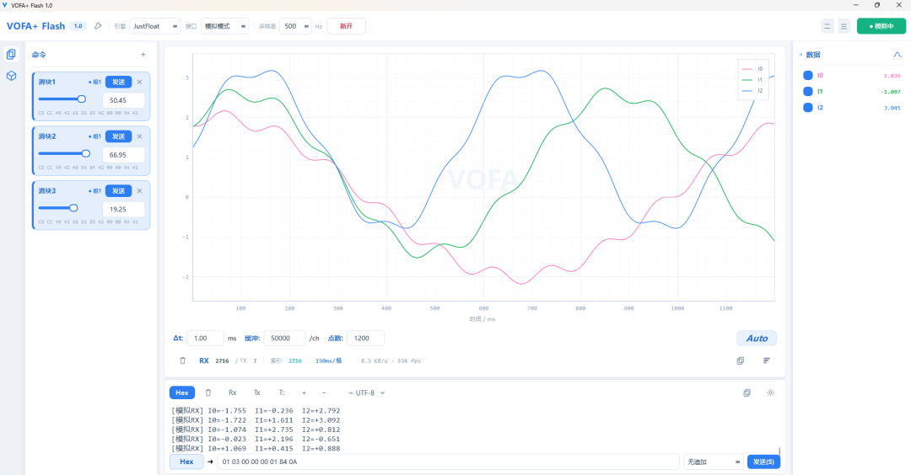
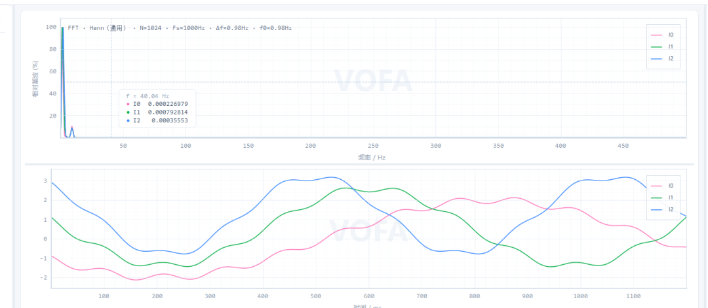

# VOFA+ Flash

**VOFA+ 的精简版串口波形上位机：打开就出曲线，拖动就改参数。**

> **非官方项目**：本项目**未获得 VOFA+ 作者的授权**，也不是官方分支或衍生发行版，
> 只是按它的界面与交互风格自行实现的开源分享。名称与视觉设计的权利归原作者，
> 如有不妥请联系，会立即调整或下线。

VOFA+ 功能很全，但现场真正高频的只有两件事：**看波形**、**改参数**。
VOFA+ Flash 就围绕这两件事做减法——去掉用不到的面板、插件和层层弹窗，
把界面压成「一条顶栏 + 一块波形 + 一列变量 + 一个命令抽屉」，让视线只跟着曲线走。

- **减少视觉干扰**：接口参数集中在一条顶栏；白底浅网格、细描边、无多余边框；
  暂停、缩放等状态提示一律放在画布之外的空白处，绝不压在曲线上
- **为快而生**：选端口 → 点连接 → 出图，三步内看到数据；参数用滑动条直接下发，
  不用改代码、不用烧录、不用一层层开对话框
- **默认即用**：默认 `8N1`、默认 JustFloat（与 VOFA+ 同协议）、默认 Auto 缩放，
  不改任何配置也能先跑起来；内置模拟模式，手边没有硬件也能先看界面

技术上用 Python + PySide6 + pyqtgraph 实现，视觉沿用 VOFA+ 的白色卡片风格，
各区域都能拖动调整；提供两种 Windows 打包版：**单文件 exe** 双击即用，
**分开版目录** 启动更快，目录里附带一键创建桌面快捷方式的脚本
（窗口内显示名称均为「VOFA+ Flash」）。

## v1.3.0 更新

- 启动画面去掉白色描边，只保留圆角卡片与柔和阴影
- 连续记录固定开启：取消缓冲上限与记录开关，完整历史一直保留，缩放后整段曲线仍可见
- 游标快捷键：`A` / `B` 进入待放置后点击落点，`C` 在未设游标时自动放左 A / 右 B；仅暂停且鼠标在波形区内生效，顶部 ▼ 可拖动
- 发送格式串：如 `S%fE,1.31` 自动打包成 `S + float32(1.31) + E`，支持多种数据类型；底部发送框与命令固定命令均可切换大端 / 小端（默认小端）
- 设置新增「波形」标签：采样间隔 Δt 与 Auto 视窗点数可调整并保存；Auto 按钮并入统计栏最右，同排更省空间
- 布局导入导出保留 Δt / 视窗点数，移除已不再使用的缓冲上限字段
- 波形刷新加绘制指纹缓存、统计 UI 限频，长时间运行更稳

## v1.2.0 更新

- 动态启动画面：淡入 + 扫光进度条 + 淡出，重模块导入延后到画面显示之后
- 串口自动重连：记住上次端口 / 波特率，掉线后静默重连，`8N1` 菜单可开关
- CSV 回放：统计栏按钮和右键菜单都可导入 CSV 重新出图
- 游标测量：暂停后点击波形设 A（开始，橙色）/ B（结束，紫色），也可拖动微调；统计栏「测量」按钮打开独立面板，多变量一起算自动控制指标
- 测量面板：`阶跃响应` / `稳态计算` 两页，初始值 / 设定值可手填，计算超调量（百分比 + 绝对值）、上升时间、峰值时间、调节时间、稳态误差、最大偏差与 RMS
- 模拟模式扩展：设置里可选正弦扫描 / 阶跃响应 / PID 响应，暂停时游标自动对准最近一次阶跃；PID 响应跑的是**真实离散闭环**（PI D 控制器 + 一阶惯性对象 + 测量微分低通 + 积分反算抗饱和 + 执行器限幅/死区），不是画出来的公式曲线，能真正收敛到设定值；切到 PID 时命令面板自动加入 `S 目标 P I D E` 四滑块组，改目标值即产生新阶跃、改 P/I/D 实时改变控制效果，三路对象参数略有差异并叠加微小随机噪声
- 多窗口智能模式：双窗上 FFT + 下时域，三窗频谱 + 时域总览 + 细节；右键可单独锁定窗口模式
- 右侧变量栏按「窗口 1 / 2 / 3」分组，支持勾选显隐与滚动
- 显示控件三轴卡片双击弹出悬浮大窗，`Esc` 关闭并还原
- 连续记录模式：默认常开，不限缓冲长度一直记录完整历史；视图只跟随最近窗口，关闭软件自动清除，不落盘
- 设置（扳手）新增「快捷键」「布局」「模拟」「记录」标签：快捷键可编辑；布局可导出 / 导入 JSON（含命令面板、协议引擎、串口/网络参数、编码与显示模式），导入即可整套恢复，投放区支持点击或拖入
- 两种打包版：`build.py` 单文件 exe；`build_fast.py` 分开版目录，附 `Create_Desktop_Shortcut.cmd`



## 界面预览

| 显示控件与三轴 | 波形右键菜单 |
| --- | --- |
|  |  |

| FFT 频谱 | 多窗口 FFT + 时域 |
| --- | --- |
|  |  |

## 和 VOFA+ 是什么关系

这是 **VOFA+ 的精简版**（个人开源项目，非官方、未获授权）：沿用 VOFA+ 的 JustFloat 协议、
RawData 兼容写法和白色卡片视觉，砍掉现场用不到的部分，换取更短的路径和更干净的界面。

| | VOFA+ | VOFA+ Flash |
| --- | --- | --- |
| 定位 | 全功能上位机平台 | 只保留「看波形 + 调参数」这一条主线 |
| 界面 | 大量面板、插件、配置项 | 一条顶栏 + 波形卡片 + 变量栏 + 命令抽屉 |
| 上手 | 需要先理解控件、协议插件、数据源配置 | 选端口点连接就出图，默认配置即可用 |
| 协议 | 多协议插件体系 | 固定 JustFloat / RawData / ASCII，够用就好 |
| 调参 | 依赖协议插件或脚本 | 滑动条 / 滑块组，拖动即下发整帧 |
| 交付 | 安装包 | 单文件 exe / 分开版目录，双击运行 |

一句话：**要插件、要脚本、要各种控件，用 VOFA+；要的是接上串口马上看到波形并改两个参数，用 VOFA+ Flash。**

## 和常见串口软件比

SSCOM、XCOM、AccessPort、CoolTerm、Tera Term、PuTTY 这类工具擅长「把收到的字节原样显示出来」，
有的也能发文本或 Hex、保存日志；但要把这些数据变成曲线、把参数变成可拖的滑块、
把一次调参变成可复现的帧格式，往往还得自己在表格里数字节、在外面画图。
VOFA+ Flash 把这些补齐，同时保留串口助手「打开就能用」的轻量感：

| | 常见串口软件（SSCOM / XCOM / AccessPort / Tera Term / PuTTY 等） | VOFA+ Flash |
| --- | --- | --- |
| 收到的数据 | Hex / 文本滚动刷屏，趋势靠肉眼或另存后用 Excel 画 | 同一路数据直接出曲线，右键切 FFT 看频谱 |
| 参数下发 | 手敲 Hex 或 AT 指令，改一个值就重敲一遍 | 滑动条 / 滑块组拖动即发，量程、字节序在卡片里选 |
| 组帧 | 自己数字节、自己拼头尾 | 头帧 + 数据 + 尾帧自动拼装，卡片底部实时预览整帧 Hex |
| 数值观察 | 盯着一排数字比对 | 变量栏实时数值、十字游标读数、三轴姿态一起看 |
| 波形分析 | 基本没有；少数工具只有简单曲线 | 单 / 双 / 三窗口、Auto 缩放、时域与频域一键切换 |
| 游标测量 | 手动数格子估算 | 暂停后点击设 A / B 游标，自动算超调、上升 / 调节时间、稳态误差 |
| 长时间记录 | 保存文本日志，事后手动清洗 | 连续记录模式不限长度，一键导出完整 CSV，关闭软件自动清除 |
| 数据留存 | 保存文本日志，事后手动整理 | 始终连续记录，CSV / PNG / 日志一键导出 |
| 连接类型 | 大多以串口为主 | 串口 / UDP / TCP 客户端 / TCP 服务端 / 模拟模式 |
| 启动成本 | 配置项散落在多个对话框 | 单文件 exe / 分开版，双击运行，主界面就是全部功能 |

一句话：**要看原始字节、发 AT 指令，串口助手顺手；要看波形趋势、拖动改参数、测自动控制指标，用 VOFA+ Flash。**

## 和 Serial Studio 等现代 / 商业工具比

Serial Studio、SerialPlot、Grafana 类串口 / 数据可视化面板，以及 LabVIEW、Dash、NetSERIAL 等
商业或付费方案，已经在「把数据画出来」上做得很好：拖拽式面板、仪表盘、云端接入、
自定义插件 / 脚本，适合搭复杂监控界面或产品级演示。VOFA+ Flash 不往这个方向堆功能，
而是把「接上串口 → 看波形 → 改两个参数 → 测一下响应」压到最短路径：

| | Serial Studio / SerialPlot 等现代工具 | 商业 / 付费方案（LabVIEW、Dash、NetSERIAL 等） | VOFA+ Flash |
| --- | --- | --- | --- |
| 定位 | 开源 / 免费的可视化面板，看重仪表盘与协议框架 | 产品级监控、仪表或自动化测试，功能全但重 | 串口波形 + 参数下发，一条主线走到底 |
| 上手 | 要配 JSON / 协议描述、拖控件布局 | 要有授权、装 runtime、学一套工程流程 | 选端口点连接就出图，默认 JustFloat 即用 |
| 波形与频谱 | 多路曲线 / 仪表盘丰富，FFT 多需插件或自行扩展 | 图表能力强，但通常要搭工程 | 单 / 双 / 三窗口，时域 + FFT 右键切换 |
| 参数下发 | 多靠自定义控件 / 脚本，需自己接串口写回 | 平台里做控件绑定和事件，工程量大 | 滑动条 / 滑块组拖动即发，字节序与帧格式可视化 |
| 自动控制测量 | 一般不直接给超调 / 调节时间 | 需自己搭算法或买分析模块 | 暂停点 A / B 游标，自动算超调、上升 / 调节时间、稳态误差 |
| 模拟数据源 | 有的要配模拟插件或外部数据源 | 常依赖工程内仿真 | 内置正弦 / 阶跃 / PID 三种模拟波形，随时验证测量 |
| 连续记录 | 看具体实现，常需自己接存储 | 通常有完整数据记录方案，但配置复杂 | 始终连续记录，关闭软件自动清除，不落盘 |
| 交付方式 | 源码 / 安装包，可能要配环境 | 授权 + 部署，交付链较长 | 单文件 exe / 分开版目录，双击即用 |

一句话：**要搭仪表盘、做产品级界面，Serial Studio / 商业平台更合适；要的是开箱即用的波形、
游标测量和拖动调参，VOFA+ Flash 更轻。**

## 和 McuStudio 是什么关系

McuStudio 走 SWD / JTAG 直连芯片，提供寄存器、变量、断点这类**芯片内部视角**；
VOFA+ Flash 只占用一路 UART（也可 UDP / TCP），提供**整机外部视角**的波形与命令通道。
两者定位互补，不抢调试接口，可以同时开着用。

| | McuStudio | VOFA+ Flash |
| --- | --- | --- |
| 连接方式 | 调试器（SWD / JTAG） | 串口 / UDP / TCP 客户端 / TCP 服务端 |
| 主要用途 | 在线调试、断点、寄存器与内存 | 波形观察、参数实时下发、命令调试 |
| 硬件前提 | 调试口可用、需共地 | 只要有一路串口 |
| 典型现场 | 台架、裸板、样机 | 整机、装配后、高压大功率、隔离供电、远程 |

一句话：**能用调试器就用 McuStudio，只有串口就用 VOFA+ Flash。**

## 解决的串口调试痛点

| 现场痛点 | 这里的做法 |
| --- | --- |
| 板子只剩 UART，或高压 / 大功率不敢和调试器共地，SWD 又被占用 | 只占用串口 TX / RX / GND，完全不碰调试接口 |
| 调一个参数要「改代码 → 编译 → 烧录」 | 滑动条拖动即下发，默认按 `float32` 打包，不改代码不重启 |
| 多个参数要拼成一帧，字节数、字节序容易算错 | 多个滑块绑成一组后按顺序自动打包，卡片底部实时预览整帧 Hex |
| 串口助手只能看十六进制，看不出趋势 | JustFloat / ASCII / RawData 三种协议直接出曲线 |
| 想同时看时域波形和频谱，只能来回切工具 | 右键即可切到 FFT，支持单窗口 / 双窗口 / 三窗口同时展示 |
| 姿态、角度数据只能盯一排数字 | 左侧「显示控件」可添加三轴坐标系，X / Y / Z 独立绑定 Rx 通道 |
| 日志太密、Hex 和文本混在一起看不清 | 接收 Hex / Abc 独立切换，支持 Ctrl + 滚轮缩放字号 |
| 波形工具要装驱动、配一堆参数才出图 | 打包版双击运行（分开版启动更快）；接设备只需选端口 + 点「连接」 |
| 手上暂时没有硬件，界面和协议没法先验证 | 内置模拟模式，点一下就有 3 通道正弦波，命令照常回显 |
| 抓到的数据留不下来，事后无法复现 | 曲线导出 CSV、截图导出 PNG、接收日志可保存 |
| 长时间采集越跑越卡、内存越吃越多 | 后端线程批量读串口、完整历史等间隔抽样绘制、日志节流 |
| 常用命令与帧格式每次都要重新敲 | 命令卡片保存头帧 / 尾帧 / 内容，一键发送 |

## 核心亮点

- **VOFA+ 的精简版**：只留看波形与调参数，界面干净、路径更短
- **两种打包任选**：单文件 exe 便于分发，分开版目录启动更快；都无控制台、不依赖 Python
- **串口 / 网络通吃**：串口、UDP、TCP 客户端、TCP 服务端、内置模拟模式
- **波形 + 频谱一起看**：单 / 双 / 三窗口，右键直接切 FFT
- **调参不用重烧程序**：命令卡片、滑动条、滑块组实时下发
- **姿态数据可视化**：左侧显示控件添加三轴，X / Y / Z 独立绑定
- **长时间采集不卡**：后台线程、完整历史抽样绘制、日志节流
- **数据留得下来**：CSV、PNG、日志保存，方便复盘

## 功能

### 数据接入

- 数据引擎：`JustFloat` / `RawData`（自动兼容 ASCII 数值行）
- 数据接口：串口 / UDP / TCP 客户端 / TCP 服务端 / 内置模拟模式，切换自动断开旧连接并切换参数面板
- 串口格式：顶栏 `8N1` 菜单可设数据位、校验位、停止位与 RTS / XON 流控
- 端口列表每 3 秒自动检测，插拔设备不用手动刷新
- 模拟模式：启动进入模拟态，点右上角「模拟模式」开始 / 暂停数据流，命令与滑动条始终可用
- 模拟数据波形：设置 →「模拟」可选正弦扫描、阶跃响应、PID 响应；后两种为带超调的二阶曲线，暂停后自动把游标对准最近一次阶跃，方便直接测性能指标

### 波形页

- 白底浅网格 + 细描边 + Consolas 刻度，纯白画布上跑抗锯齿曲线
- 浅色 / 深色主题一键切换，画布、坐标轴、图例、读数面板同步换色
- 暂停状态只在波形卡片外的统计栏提示，画布上不压任何浮层
- 右上角图例跟随变量名、颜色、显隐实时变化
- 鼠标移入即可显示十字游标与读数面板（时间 / 频率 + 各通道当前值），无需先暂停
- `空格` 只暂停 / 恢复波形，不会断开连接；暂停默认不显示游标
- 暂停且鼠标在波形显示区内时：`A` / `B` 进入待放置状态，**再点击波形对应位置**才放置游标 A / B；若从未设过游标直接按 `C`，则在可见区左 15% / 右 85% 放好 A / B 并显示；已设过游标时 `C` 切换显示/隐藏（均可在设置→快捷键中改）。其它情况快捷键无效。游标顶部有 ▼ 标记可拖动微调，点击统计栏测量按钮看指标
- 支持 **单窗口 / 双窗口 / 三窗口** 显示，顶栏 `二 / 三` 按钮一键切换
- 智能模式：`二窗` 自动「上 FFT + 下时域」，`三窗` 自动「频谱 + 时域总览 + 时域细节」；右键可单独锁定某窗口模式
- 右键单个波形区可切 `时域波形` / `频域分析（FFT）`、显示变量、Auto、导出与清空，操作只作用于该窗口
- FFT 支持 Hann / Hamming / Blackman / Flat Top / 矩形窗，纵轴可选相对基波 (%) / 幅值 / dBc
- 曲线绘制完整历史，点数过多时等间隔抽样；Auto 只跟随最近视窗，长时间采集也不掉帧
- **Auto** 一键同时适配 X 轴（跟随最新数据窗口）与 Y 轴（按可见数据留边距）；
  手动滚轮缩放或拖动会自动关闭 Auto，把视图交回给你；**双击波形区**即可恢复 Auto
- Auto 按钮已并入统计栏最右侧同一行；Δt 与视窗点数在「设置 → 波形」中调整，缓冲上限已移除
- 统计栏：接收帧数、发送帧数、采样索引、每格毫秒数、实时吞吐（KB/s）与帧率（fps）
- 统计栏「测量」按钮：暂停后点击波形设 A / B 游标，打开专用面板计算阶跃与稳态性能
- 连续记录：始终开启，不限缓冲长度，关闭软件自动清除
- 暂停即进入游标模式：运行时不显示游标，暂停后可点击设点或拖动微调，右键也可单独关闭

### 显示控件

- 左侧「显示控件」栏默认收起，点击左侧立方体按钮展开
- 可添加多个 `三轴坐标系` 控件，每个控件独立存在
- 双击卡片空白处弹出悬浮大窗，按 `Esc` 关闭并放回原位
- X / Y / Z 三个轴可分别绑定任意 Rx 通道，也可选择 `不绑定`
- 角度单位支持「角度 / 弧度」切换，三轴姿态和数值标签同步更新
- 三轴使用轻量 QPainter 绘制，不依赖 OpenGL，和波形同时显示不抢性能
- 控件跟随浅色 / 深色主题，X 红、Y 绿、Z 蓝

### 变量与导出

- 右侧变量栏只显示当前有数据的变量，勾选显隐、实时显示数值
- 多窗口时按「窗口 1 / 2 / 3」分组，每组独立勾选显隐；切换活动窗口自动高亮，数据过多时可滚动
- 双击变量行 / 右键可改名称、颜色、增益、偏置、小数位
- 当前缓冲导出 CSV（时间 + 各变量列）：连续记录模式下导出完整历史；也可把波形卡片导出 PNG

### 收发展示

- 接收日志支持 Hex / Abc 独立切换、时间戳、Rx-Tx 过滤、字号调整 / 保存
- 日志区支持 `Ctrl + 滚轮` 缩放字号
- 发送支持 Hex 与 Abc 文本两种模式，可追加换行 / 回车换行，文本编码可切 UTF-8 / GBK / ASCII
- 模拟模式下发送同样计入 TX，日志中保留 `[tx]` 回显

## 命令面板

命令分两类，名称留空时自动编号（命令1、滑块1、组1…）。编号会**优先补上被删掉留下的空号**：
删掉「滑块1」再新增，仍然是「滑块1」，不会一路涨成 滑块2 / 滑块3。

- **固定命令**：头帧（可选）+ 固定内容 + 尾帧（可选）
- **滑动条**：把数值按所选格式打包（默认 `float32` 小端），再拼上头帧 / 尾帧
- **滑块组**：多个滑块填写相同「绑定组」名称后，按界面顺序连续打包，一次发一整帧
- **自建滑动组**：`+` →「自建滑动组…」一次配置组名、滑块数量、每个滑块的数据类型（不限 `float`）与量程、头帧/尾帧、字节序和 CRC 校验，拖动即按自定义协议发整帧；CRC 可选 CRC-8 / CRC-16/Modbus / CRC-32，追加在数据之后、尾帧之前，卡片标题会显示校验徽标


### 帧内容怎么写：Hex 或文本都行

头帧、尾帧和固定命令内容都同时支持两种写法，不用先切模式：

| 写法 | 输入 | 实际发送 |
| --- | --- | --- |
| 十六进制 | `AA 55`、`AA55`、`0xAA,0x55` | `AA 55` |
| 文本（前缀） | `text:AT+RESET\r\n` | 文本按当前编码编码后的字节 |
| 文本（英文引号） | `"hello"` | `hello` |
| 强制 Hex | `hex:AA 55` | `AA 55` |
| 自动 | `AT+RESET` | 出现非十六进制字符，自动按文本发送 |

规则很简单：

- 全是十六进制字符（`0-9 A-F`，允许空格 / 逗号 / 冒号 / 下划线分隔）→ 按 Hex 解析，位数需为偶数
- 出现其它字符（如 `SET`、`AT+RESET`）→ 按文本发送，编码跟随底部 `⌁ UTF-8 / GBK / ASCII`
- 文本支持 `\r`、`\n`、`\t`、`\0` 转义，尾帧可以直接写 `text:\r\n`
- 想发的内容恰好也像十六进制（例如字母串 `ABCD`），加英文引号或 `text:` 即可强制按文本发送

例如 3 个 float32 滑块绑定为同一组，头帧 `AA 55`、尾帧 `00 00 80 7F`：

```text
AA 55 | v0(float32 LE) | v1(float32 LE) | v2(float32 LE) | 00 00 80 7F
```

一帧共 2 + 12 + 4 = 18 字节，下位机按固定长度解析即可。数据类型支持
`float32 / int32 / uint32 / int16 / uint16 / int8 / uint8`，字节序可选小端或大端，
卡片底部会实时预览即将发出的完整帧。

使用细节都在卡片上直接完成，不用来回开对话框：

| 操作 | 效果 |
| --- | --- |
| 拖动滑块 | 实时下发整组数据（右键「拖动时实时发送」可关闭） |
| 拖到两端后继续滚轮 / 方向键 | 突破当前上下限，自动扩展量程 |
| 双击数值框 | 全选整段数字，直接覆盖输入 |
| 手动输入数值后回车 | 量程自动适配：输入 `2` 收紧到 `-5~5`，输入 `2000` 放大到 `-3000~3000` |
| 双击标题 | 就地改名 |
| 双击组徽标 | 改组名，同组滑块一起改 |
| 右键组徽标 | 一键换整组配色（自动配色或蓝 / 绿 / 紫 / 橙 / 青 / 红） |
| 点删除按钮 | 属于滑块组时整组一起删除，独立滑块只删自己 |

组配色会自动避让已用颜色，所以新建的组默认就是不同色；手动换色后同组卡片底色、
左侧色条、滑轨与徽标一起变。

## 数据协议

JustFloat（推荐，与 VOFA+ 一致）：

```text
float32 LE ch0 | float32 LE ch1 | ... | 00 00 80 7F
```

兼容的 ASCII 行协议：

```text
1.23,2.34,3.45\n
```

RawData 模式下每行可以是 `00 00 80 3F ...` 这类十六进制文本、逗号分隔的十进制数，
或直接的小端 float32 二进制帧。

## 操作速查

| 操作 | 效果 |
| --- | --- |
| 顶部「接口」下拉 | 切换串口 / UDP / TCP 客户端 / TCP 服务端 / 模拟模式 |
| 顶部「连接 / 断开」 | 建立或断开当前接口；模拟模式下控制数据流 |
| `空格` | 只暂停 / 恢复波形，不断开连接 |
| 顶部 `8N1` | 设置数据位、校验位、停止位与流控 |
| 顶栏 `二 / 三` | 切换双窗口 / 三窗口显示；再次点击恢复单窗口 |
| 统计栏测量 | 打开游标测量面板，计算阶跃响应 / 稳态性能指标 |
| 连续记录 | 始终开启，不限缓冲长度；关闭软件自动清除 |
| 设置 → 波形 | 调整采样间隔 Δt 与 Auto 视窗点数；两项设置会保存，下次启动继续生效 |
| 统计栏截图 / 清空 | 导出当前波形图片 / 清空波形缓冲与统计 |
| 左侧命令图标 | 展开或收起命令抽屉 |
| 左侧立方体图标 | 展开或收起「显示控件」栏 |
| 显示控件 `+` | 添加三轴坐标系，三轴可独立绑定 Rx 通道 |
| 命令面板 `+` / 空白处右键 | 新增固定命令、单个滑动条、自建滑动组（含 CRC），或一次新增 2 / 3 / 4 个滑块组 |
| 命令卡片双击 / 右键「设置…」 | 设置名称、类型、数据格式、量程、头帧、尾帧、绑定组；固定命令可填格式串，设置里可选字节序，双击内容框也可切换大端 / 小端 |
| 波形区右键 | 显示变量、变量设置、游标测量 A/B、导出 CSV / PNG、清空、显示模式、FFT 窗函数、FFT 纵轴 |
| 「Auto」 | 自动适配 X / Y 轴；手动缩放会退出，双击波形恢复 |
| 右侧「数据」栏 `›` | 收起为窄条，点图标再展开 |
| 底部 `Hex / Abc` | 独立切换接收显示格式 |
| 底部发送行 `Hex / Abc` | 独立切换发送格式 |
| 发送框格式串 | 直接输入 `S%fE,1.31` 自动打包成 `S + float32(1.31) + E`；支持 `%f` float32、`%d` int32、`%u` uint32、`%h` int16、`%H` uint16、`%b` int8、`%B` uint8、`%q/%Q` 64 位、`%l` float64，逗号依次填值；**双击发送框**切换大端/小端（默认小端）；命令面板固定命令同样支持格式串，在命令设置里选择字节序 |
| 底部 `⌁ UTF-8` | 切换文本发送编码 |
| 底部 Rx / Tx / `T:` | 只看接收、只看发送、日志加时间戳 |
| 日志区 `Ctrl + 滚轮` | 缩放日志字号 |
| 拖动面板分隔条 | 调整显示控件、命令面板、变量栏宽度、收发区高度 |

## 运行与打包

```bash
pip install -r config/requirements.txt

python main.py        # 源码运行
python build.py       # 单文件 exe：dist/VOFA_Flash.exe
python build_fast.py  # 分开版目录：dist/VOFA_Flash/
```

- 源码运行不需要打包。两种打包版都不需要目标电脑安装 Python，串口驱动由系统提供。
- `python build.py`（单文件版）：
  - `dist/VOFA_Flash.exe`：双击即用；每次启动会解压到临时目录，适合临时分发一个文件。
  - Release 直接上传这个裸 exe，**不生成 zip / txt**；SHA256 只在打包时打印到控制台。
- `python build_fast.py`（分开版，启动快）：
  - `dist/VOFA_Flash/VOFA_Flash.exe` + 依赖目录：不解压临时目录，冷启动更快。
  - `dist/VOFA_Flash/Create_Desktop_Shortcut.cmd`：双击后在桌面建立 `VOFA+ Flash` 快捷方式；使用 CMD + PowerShell，不生成 VBS，避免杀毒误报。
  - `dist/VOFA_Flash_v1.3.0_win64_onedir.zip`：整个目录 + README + 截图，Release 上传这个 zip；不生成 txt。
- 两种 exe 文件属性中均写入版本、产品名和说明。
- 选择建议：频繁使用 / 低配电脑用分开版；只发一个文件给别人时用单文件版。

启动后默认停在「模拟模式」（未开始采集）：点右上角「模拟模式」按钮即开始出模拟波形，
命令与滑动条也能直接发送并在日志里回显。接真实设备时把顶部接口切到「串口」，
选好端口与波特率，点「连接」即可收发下位机数据。

## 目录结构

```text
vofa/
├── main.py                  # 程序入口
├── build.py                 # 打包单文件 exe，SHA256 仅打印到控制台
├── build_fast.py            # 打包分开版目录、快捷方式脚本与发布 zip
├── README.md
├── config/requirements.txt
├── assets/                  # 运行期图标等资源
├── docs/screenshots/        # README 界面截图
└── vofa/
    ├── __init__.py          # 版本号
    ├── main_window.py       # 主窗口编排：数据流、多窗口、布局与业务入口
    ├── ui/                  # 复用 UI：小控件、显示控件、对话框
    │   ├── common.py        # 布局助手、通道行、通用小控件
    │   ├── display.py       # 三轴显示控件与悬浮卡片
    │   ├── dialogs.py       # 变量编辑与设置对话框
    │   └── measure.py       # 游标测量面板与自动控制性能指标
    ├── command_panel.py     # 命令卡片、滑动条、组帧与组配色
    ├── plot_widget.py       # 波形页、FFT、游标、Auto、多窗口数据
    ├── protocol.py          # JustFloat 帧解析与 RawData 文本转换
    ├── serial_worker.py     # 后台串口线程
    ├── transport.py         # UDP / TCP 客户端 / TCP 服务端
    ├── theme.py             # 配色、字体与全局样式表
    ├── icons.py             # 矢量图标
    └── widgets.py           # 通用小控件
```

## 性能与稳定性

- 串口线程批量读取：单次最多 256 KB，按 10 ms 合并上报，避免高频信号压垮主线程
- JustFloat 解析单次扫描后统一裁剪，复杂度 O(n)；缓冲区超过 1 MB 自动丢弃残帧
- RawData 日志 150 ms 节流并限制 4000 行
- 波形绘制完整历史并按点数等间隔抽样，数据量再大也只画约 2 万点
- 连续记录始终开启，不限缓冲长度，绘制完整历史时等间隔抽样；关闭软件即清除
- 解析异常被捕获并记录，不会中断接收；断开或切换接口自动清理变量与缓冲
- 实测 5000 帧 × 4 通道（约 98 KB）一次性解析约 40 ms，可稳定承载常见工业串口吞吐

## 说明与免责声明

- **未获授权**：本项目**没有得到 VOFA+ 作者的授权或认可**，与原作者无任何隶属、合作或赞助关系，
  也不是官方版本。它只是按 VOFA+ 的界面与交互风格自行实现的独立项目，纯属开源分享。
- **名称与视觉归属**：README 与界面中出现的「VOFA」字样仅用于说明数据协议来源与设计参考；
  VOFA+ 的名称、标识、界面视觉与相关素材的权利均归原作者所有，本项目不主张任何相关权利，
  也未使用其闭源代码或安装包内容。
- **代码使用**：本项目代码以 MIT 风格自由使用（保留出处即可），不提供任何形式的担保，
  因使用本项目造成的任何直接或间接损失由使用者自行承担。
- **尊重原作者**：如果原作者认为本项目的命名、截图或界面风格存在不当使用，请联系后
  会立即改名、调整或下线相关内容。
- **其他**：与 McuStudio 无隶属关系，文中提及仅用于说明定位差异。
